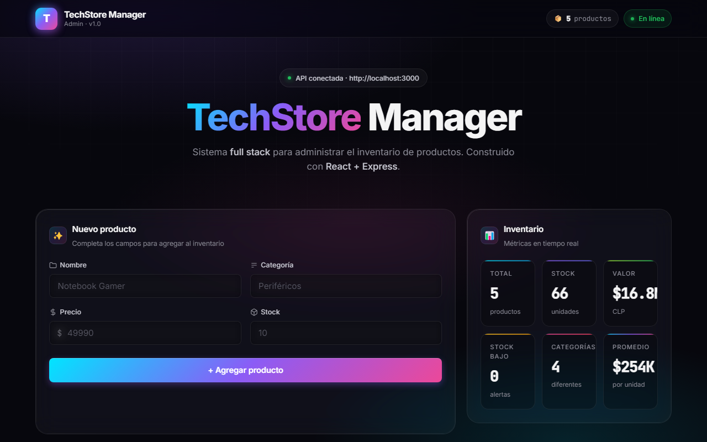

# TechStore Manager — Evaluación Sumativa 4

[](https://github.com/Fernandamv96/TechStoreManager/actions/workflows/ci.yml)
[](LICENSE)

**Demo:** <https://techstore-api-one.vercel.app>



Sistema **Full Stack** para administrar el inventario de productos de la
empresa **TechStore SPA**, desarrollado como parte de la **Evaluación
Sumativa 4** de la asignatura *Programación Front End* (TI 3031).

> 🎨 **Diseño 2026** — Dark mode, glassmorphism, gradientes neón, bento
> grid, animaciones suaves y micro-interacciones.

---

## 📋 Caso práctico

La empresa **TechStore SPA** (comercializadora de productos tecnológicos)
necesita una aplicación web que permita administrar su inventario,
realizando operaciones **CRUD** sobre la entidad **Producto**.

### Modelo de datos — `Producto`

| Campo      | Tipo    |
| ---------- | ------- |
| `id`       | Number  |
| `nombre`   | String  |
| `categoria`| String  |
| `precio`   | Number  |
| `stock`    | Number  |

---

## 🧱 Arquitectura

```
techstore/
├── backend-techstore/     # API REST con Node.js + Express
└── frontend-techstore/    # SPA con React + Vite (diseño dark)
```

### Stack tecnológico

| Capa        | Tecnologías                                            |
| ----------- | ------------------------------------------------------ |
| Backend     | Node.js · Express 4 · CORS                             |
| Frontend    | React 18 · Vite 5 · HTML5 · CSS3 · JavaScript ES6      |
| HTTP client | Axios                                                  |
| Estilos     | CSS3 (variables, backdrop-filter, grid, flexbox)       |
| Tipografía  | Inter (UI) + JetBrains Mono (datos numéricos)          |
| Persistencia| En memoria (`data/productos.js`)                       |

---

## 🚀 Cómo ejecutar el proyecto

Necesitas **dos terminales** abiertas.

### 1) Backend (puerto 3000)

```bash
cd backend-techstore
npm install
npm start
```

Verás en consola:

```
===============================================
 TechStore Manager API
 Ejecutándose en http://localhost:3000
===============================================
```

### 2) Frontend (puerto 5173)

```bash
cd frontend-techstore
npm install
npm run dev
```

Abre en el navegador: **http://localhost:5173**

> Para probar el build de producción:
> ```bash
> npm run build
> npm run preview     # sirve dist/ en http://localhost:4173
> ```

---

## 📡 API REST — Endpoints

Base URL: `http://localhost:3000/productos`

| Método | Ruta                | Descripción              | Éxito | Error         |
| ------ | ------------------- | ------------------------ | ----- | ------------- |
| GET    | `/productos`        | Listar todos             | 200   | 500           |
| GET    | `/productos/:id`    | Obtener por id           | 200   | 400, 404      |
| POST   | `/productos`        | Crear nuevo              | 201   | 400, 500      |
| PUT    | `/productos/:id`    | Actualizar               | 200   | 400, 404, 500 |
| DELETE | `/productos/:id`    | Eliminar                 | 200   | 400, 404, 500 |

### Códigos HTTP

- `200 OK` — operación exitosa
- `201 Created` — recurso creado
- `400 Bad Request` — error de validación
- `404 Not Found` — recurso no encontrado
- `500 Internal Server Error` — error inesperado

### Validaciones del servidor

- `nombre`: obligatorio, no vacío
- `categoria`: obligatoria, no vacía
- `precio`: obligatorio, numérico, > 0
- `stock`: obligatorio, numérico, ≥ 0

---

## 🖥️ Frontend — Estructura React

```
frontend-techstore/
└── src/
    ├── App.jsx                        # Estado global + handlers CRUD
    ├── main.jsx                       # Bootstrap React
    ├── components/
    │   ├── Navbar.jsx                 # Header glassmorphism sticky
    │   ├── FormularioProducto.jsx     # Form crear/editar + validaciones
    │   ├── TablaProductos.jsx         # Tabla con búsqueda + ordenamiento
    │   ├── Producto.jsx               # Fila individual
    │   ├── Stats.jsx                  # Métricas en tiempo real
    │   ├── Toast.jsx                  # Sistema de notificaciones
    │   └── Footer.jsx                 # Pie minimalista
    ├── services/
    │   └── api.js                     # Capa Axios
    └── styles/
        ├── global.css                 # Tema dark + variables CSS
        ├── App.css                    # Bento grid + hero + toasts
        ├── Navbar.css
        ├── FormularioProducto.css
        ├── TablaProductos.css
        └── Footer.css
```

### Hooks y patrones React utilizados

- ✅ `useState` — formulario, lista, toasts, búsqueda, orden
- ✅ `useEffect` — carga inicial + cleanup de timers
- ✅ `useMemo` — filtrado y ordenamiento optimizado
- ✅ `useRef` — timeouts de toasts
- ✅ `useCallback` — handlers memoizados
- ✅ Props — comunicación padre ↔ hijos
- ✅ Eventos — `onChange`, `onSubmit`, `onClick`
- ✅ Componentes — separación por responsabilidad

### 🎨 Sistema de diseño

**Paleta dark con acentos neón:**

- Fondo base: `#07070d` con halos radiales morado/cyan/rosa
- Glassmorphism: `backdrop-filter: blur(20px) saturate(180%)`
- Gradientes: cyan → púrpura → rosa (`#00e5ff → #8b5cf6 → #ec4899`)
- Tipografía: **Inter** (UI) + **JetBrains Mono** (datos)
- Acentos: verde (éxito), rojo (error), ámbar (warning), cyan (info)

**Componentes UI destacados:**

- ✨ **Navbar sticky** glassmorphism con logo gradiente, contador de
  productos y badge "En línea" con pulso animado
- 🎯 **Hero** con badge de estado de API, título con gradiente y
  subtítulo
- 📐 **Bento grid** con form grande + panel de stats
- 📊 **Stats cards** con borde superior gradiente y métricas en vivo
  (total, stock, valor, stock bajo, categorías, promedio)
- 🔍 **Búsqueda en vivo** que filtra por nombre, categoría o id
- ↕️ **Ordenamiento** por cualquier columna (id, nombre, categoría,
  precio, stock)
- 💀 **Skeleton loader** durante la carga inicial
- 🟢 **Iconos SVG** para editar/eliminar con glow al hover
- 🍞 **Sistema de toasts** (success/error/info) con auto-dismiss
- 📱 **Responsive**: tabla se transforma en tarjetas en móvil
- 🆔 IDs con zero-padding monoespaciados (`#001`, `#002`…)

### Validaciones frontend (cliente)

- Nombre obligatorio (≥ 2 caracteres)
- Categoría obligatoria
- Precio obligatorio, numérico, > 0
- Stock obligatorio, numérico, ≥ 0

> El frontend valida **antes** de enviar al servidor, mostrando
> mensajes por campo. El servidor **vuelve a validar** para
> garantizar la integridad.

### Funcionalidades implementadas

- ➕ **Crear** producto desde el formulario
- 📋 **Listar** productos al cargar la página
- ✏️ **Editar** producto desde la tabla (carga datos al form)
- 🗑️ **Eliminar** producto (con confirmación)
- 🔎 **Buscar** producto en vivo (nombre/categoría/id)
- ↕️ **Ordenar** por cualquier columna
- 📊 **Stats en tiempo real** que se actualizan con cada operación
- 🔄 **Actualización automática** de la tabla tras cada operación
- 🍞 **Notificaciones toast** con tipo, título, mensaje y auto-close
- 💀 **Skeleton** mientras carga
- 📱 **Diseño responsive** total
- ⚠️ **Manejo de errores** del backend con mensajes al usuario

---

## 📂 Estructura Backend

```
backend-techstore/
├── package.json
├── server.js                       # Entry point + middlewares globales
├── routes/
│   └── productos.routes.js         # Definición de endpoints
├── controllers/
│   └── productos.controller.js     # Lógica + validaciones
├── middlewares/
│   └── logger.js                   # Log: método, ruta, fecha/hora
└── data/
    └── productos.js                # Capa de datos en memoria
```

### Middleware Logger

Cada request imprime por consola:

```
┌─────────────────────────────────────────────
│  GET /productos
│  13-07-2026 16:58:34
└─────────────────────────────────────────────
```

---

## ✅ Checklist de la rúbrica

- [x] Backend con Node.js + Express.js
- [x] Frontend con React, HTML5, CSS3, JavaScript
- [x] API REST con CRUD completo
- [x] Consumo de API con Axios
- [x] Componentes: Navbar, FormularioProducto, TablaProductos,
      Producto, Footer (+ Stats, Toast)
- [x] Hooks `useState` y `useEffect` (también `useMemo`,
      `useRef`, `useCallback`)
- [x] Props y eventos
- [x] Validaciones en cliente **y** servidor
- [x] Códigos HTTP correctos (200, 201, 400, 404, 500)
- [x] Manejo de errores
- [x] Diseño responsive con Flexbox/Grid
- [x] Interfaz organizada, funcional y moderna
- [x] Middleware Logger
- [x] Estructura de carpetas (routes, controllers, middlewares, data)
- [x] Buscar por id (incluido en búsqueda en vivo)

---

## 🔒 Seguridad y calidad

- CORS restringible con `FRONTEND_URL` (ver `backend-techstore/.env.example`); sin cabecera `X-Powered-By`.
- Los errores no exponen detalles internos en producción.
- Tests de la API con `node:test` (CRUD, validaciones, JSON malformado) y CI con lint y build del frontend.
- CodeQL, Dependabot y gitleaks (pre-commit). Para reportar vulnerabilidades, mira [SECURITY.md](SECURITY.md).

Tests del backend: `cd backend-techstore && npm test`

## 💡 Qué aprendí

- A separar un backend Express en rutas, controladores y middleware, con validación en el servidor como fuente de verdad.
- A consumir la API desde React con una capa de servicios (Axios) y manejo de errores legible.
- A desplegar frontend y API juntos en Vercel con rewrites hacia una función serverless.
- Que un manejador de errores no debe devolver `err.message` al cliente en producción.

## 📄 Licencia

[MIT](LICENSE) © 2026 Fernanda (Fernandamv96)

## 👩‍🎓 Autor

**Daniela Muñoz** — Programación Front End (TI 3031)
Sede Valparaíso — 14/07/2026
